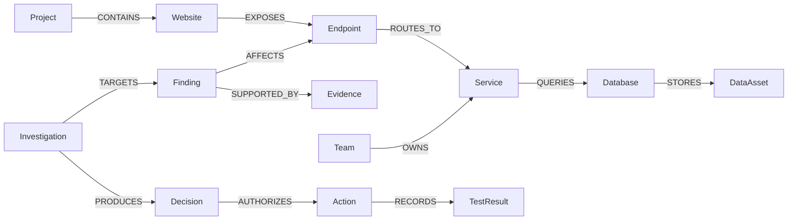

# TraceShield-AI
### Graph-Powered Autonomous Security Investigation & Verification

**TraceShield-AI** is an explainable, defensive security platform that turns isolated vulnerability findings into **connected, explainable, and actionable investigations**. It connects security findings, service dependencies, empirical evidence, deployment topology, and verification results in **FalkorDB** to help security engineers understand vulnerability blast radius, assess root-cause hypotheses, and execute authorized regression verifications with AI assistance.

Instead of only reporting that an endpoint may be vulnerable, TraceShield-AI traces **which service owns it, which database it reaches, which sensitive assets could be affected, which team is responsible, and what authorized verification should happen next**.

> **Safety Boundary:** This is an authorized defensive demonstration platform using synthetic demo targets and allow-listed actions. It is **not** an unrestricted production scanner or auto-remediation platform.

---

## ⚡ The Problem: Alert Fatigue in Modern AppSec

Modern Application Security scanners (DAST, SAST, dependency checkers) generate dozens or hundreds of isolated alerts:
* *"BOLA detected on `/api/orders/{id}`"*
* *"Missing Content-Security-Policy on `/`"*
* *"Outdated dependency in microservice A"*

**The issue:** Vulnerabilities do not exist in isolation. Disconnected scanners don't show:
* Which backend microservice owns the endpoint?
* What database does it query?
* Does that database hold public product catalogs or high-risk customer PII?
* Has an engineer deployed a fix, and has anyone performed a regression check?

TraceShield-AI connects the dots using a **Security Knowledge Graph** in FalkorDB.

---

## 🚀 Key Features

| Capability | What TraceShield-AI does |

|---|---|
| **Connected Security Knowledge Graph** | Links websites, endpoints, services, databases, sensitive assets, findings, evidence, projects, and owner teams in FalkorDB. |
| **Attack Path & Blast Radius Analysis** | Traverses multi-hop relationships to uncover the end-to-end blast radius down to sensitive data stores. |
| **Interactive Cytoscape.js SOC Dashboard** | Modern React + Vite interface with an interactive graph explorer, 1-hop neighbor expansion, finding lifecycle badges, and investigation console. |
| **FastAPI REST Service Layer** | REST endpoints with strict Pydantic schemas, RFC-compliant error envelopes, and CORS support. |
| **Contextual Risk Scoring** | Deterministic inherent-impact heuristic combining severity, data sensitivity, and reachable dependencies. |
| **Graph-Directed Autonomy & Action Policy** | Selects and executes approved, safe local verification checks based on graph context and strict safety policies. |
| **Multi-Agent Collaboration** | Investigator agent prepares shared graph state; Verifier agent reads FalkorDB and executes approved checks. |
| **Persistent Audit Trail** | Records investigations, decisions, actions, and regression test results directly in FalkorDB. |

---

## 🏗️ Architecture

```text
React + Vite SOC Dashboard (Port 5173) ──┐
Streamlit Security UI (Port 8501)      ──┤
                                          ▼
FastAPI Service Layer (Port 8000) & Autonomous Agent Engine
         │
         ├── Graph Intelligence & Action Policy (Deterministic Safety)
         ├── LangGraph / Gemini Investigator & Verifier Agents
         ├── Permitted Scanners & Evidence Ingestion Normalizers
         ▼
FalkorDB Security Knowledge Graph (Port 6379)
         ▲
         └── DemoShop Vulnerable Target App (Port 5001)
```

### Connected-Data Model



### The Connected Cypher Query in Action

A single Cypher query traverses the full stack down to the data classification level:

```cypher
MATCH (f:Finding {id: 'F-001'})-[:AFFECTS]->(e:Endpoint)
      -[:ROUTES_TO]->(s:Service)
      -[:QUERIES]->(d:Database)
      -[:STORES]->(a:DataAsset)
RETURN f.title AS Finding, e.path AS Endpoint, s.name AS Service, 
       d.name AS Database, a.name AS Asset, a.classification AS Sensitivity;
```

---

## 🤖 Multi-Agent Collaborative Workflow

TraceShield-AI uses a two-agent collaborative workflow with a shared, persistent graph state:

```text
┌───────────────────────┐
│  Investigator Agent   │
│  (Google Gemini LLM)  │
└───────────┬───────────┘
            │ 1. Queries graph topology & correlates evidence
            │ 2. Computes inherent blast radius
            │ 3. Writes structured Investigation Handoff to FalkorDB
            ▼
┌───────────────────────┐
│  FalkorDB Graph State │
└───────────┬───────────┘
            │ 4. Verifier reads handoff state from FalkorDB
            ▼
┌───────────────────────┐
│    Verifier Agent     │
│  (Safety Constrained) │
└───────────┬───────────┘
            │ 5. Executes allow-listed test against target
            │ 6. Emits immutable TestResult node into graph
            ▼
┌───────────────────────┐
│ Status: [REMEDIATED]  │
└───────────────────────┘
```

### Safety Guardrails (`action_policy.py`)
* Autonomous execution is strictly confined to read-only, allow-listed endpoints on approved local/demo targets.
* Arbitrary terminal commands and unvalidated URLs are blocked by deterministic code validators before any request fires.
* If Gemini is unavailable or quotas are exceeded, the platform seamlessly falls back to a deterministic Cypher-based reasoning loop without crashing.

---

## 🛡️ Demonstration Findings

| Finding ID | Title | Vulnerability Type | Severity | Affected Endpoint | Sensitive Data Exposed |
|---|---|---|:---:|---|:---:|
| **`F-001`** | Broken Object Level Authorization (BOLA) | `BOLA` | High (4) | `/api/orders/{id}` | **Yes** (`customer-orders`) |
| **`F-002`** | Missing Content Security Policy | `MISSING_CSP` | Low (2) | `/` & `/api/products` | No (Public Catalog) |
| **`F-003`** | *(Legacy alias for F-002)* | `MISSING_CSP` | Low (2) | `/` | No |
| **`F-004`** | *(Legacy alias for F-001)* | `BOLA` | High (4) | `/api/orders/{id}` | **Yes** |

### Scenario Walkthrough: BOLA (`F-001`)
1. **Detection & Ingestion:** The scanner verifies that Bob (User B) receives `HTTP 200` accessing Alice's order. Finding moves from `UNVERIFIED` to `CONFIRMED`.
2. **Blast Radius Computation:** Graph traversal reveals `Orders Service` queries `customer-orders` (classified as **sensitive**). Risk heuristic is prioritized to **High (Severity 4 / 90 Inherent Impact)**.
3. **Remediation & Regression Check:** Once the security patch is applied, the Verifier triggers the two-user check:
   - Alice requests order $\rightarrow$ `HTTP 200` (Allowed)
   - Bob requests Alice's order $\rightarrow$ `HTTP 403 Forbidden` (Blocked)
4. **State Transition:** The platform writes an immutable `TestResult` node into FalkorDB and transitions finding status to **`REMEDIATED`**.

---

## 📂 Project Structure

```text
TraceShield-AI/
├── api/                            # FastAPI REST service layer
│   ├── main.py                     # API entrypoint and CORS middleware
│   ├── routes/                     # Findings, Graph, Projects, Scans, Investigations
│   ├── schemas.py                  # Pydantic request/response models
│   └── services/                   # Graph, finding, scan, and AI investigation services
├── frontend/                       # React + Vite SOC dashboard
│   ├── src/
│   │   ├── components/             # Cytoscape graph canvas, toolbar, node details
│   │   ├── pages/                  # Overview, Findings, Graph, Investigations, Scans
│   │   └── services/api.ts         # Centralized API boundary
│   ├── Dockerfile                  # Multi-stage production build
│   └── nginx.conf                  # Nginx reverse proxy routing /api to backend
├── demoshop/                       # Local synthetic vulnerable target application
├── scanners/                       # Permitted local HTTP security checks (BOLA, Headers)
├── ingestion/                      # Canonical schemas, normalizer, and graph writers
├── action_policy.py                # Allow-listed action-selection policy
├── agent.py                        # Graph analysis agent
├── agent_autonomous.py             # Gemini agent with autonomy tools
├── agent_autonomy_tools.py         # Safe tool interfaces for autonomy
├── autonomous_investigator.py      # Deterministic graph-directed executor
├── multi_agent_workflow.py         # Investigator → Verifier two-agent workflow
├── graph_db.py                     # FalkorDB connection client
├── graph_intelligence.py           # Graph traversal, blast radius, and risk reasoning
├── graph_tools.py                  # Basic graph tools
├── dashboard.py                    # Streamlit security dashboard
├── seed_graph.py                   # Seeds DemoShop synthetic topology
├── seed_operational_context.py     # Seeds projects and team ownership context
├── docker-compose.yml              # Local multi-container orchestration
└── requirements.txt                # Python dependencies
```

---

## 💻 Local Quickstart

### 1. Environment Setup
```bash
python -m venv .venv
# Windows:
.venv\Scripts\activate
# Linux/macOS:
source .venv/bin/activate

pip install -r requirements.txt
cp .env.example .env
```

Configure `.env`:
```dotenv
FALKORDB_HOST=localhost
FALKORDB_PORT=6379
FALKORDB_GRAPH=traceshield
GOOGLE_API_KEY=YOUR_GEMINI_API_KEY
GEMINI_MODEL=gemini-2.5-flash-lite
```

### 2. Start FalkorDB & Seed Graph
```bash
docker compose up -d falkordb
python seed_graph.py
python seed_operational_context.py
```

### 3. Run DemoShop
```bash
python demoshop/app.py --secure --port 5001
```

### 4. Launch Services
* **FastAPI Backend**:
  ```bash
  uvicorn api.main:app --reload --port 8000
  ```
* **React SOC Dashboard**:
  ```bash
  cd frontend && npm install && npm run dev
  ```
* **Streamlit UI**:
  ```bash
  streamlit run dashboard.py
  ```

---

## 🧪 Testing & Validation

```bash
# Run pytest suite (87 unit, schema, and API tests)
pytest -v

# Run Python unittest suite
python -m unittest discover -s tests -p "test_*.py"

# Preview autonomous action plan without LLM
python autonomous_investigator.py plan F-001
```

---

## 🔒 Security & Scope Boundaries

1. **Local & Permitted Scopes Only:** Scanners strictly validate target URLs against authorized hosts (`localhost`, `127.0.0.1`, `demoshop`).
2. **Read-Only / Regression Testing:** Automated verification only performs authorized regression checks against synthetic accounts.
3. **Audit Trail Immutability:** Decisions, actions, and test results are permanently persisted to FalkorDB.
4. **Human in the Loop:** Real remediation and deployment changes require explicit human authorization; the system never alters production code autonomously.
