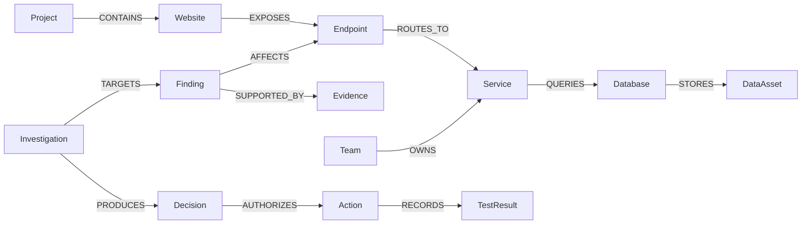

# TraceOps AI (TraceShield)
### Graph-Powered Autonomous Security Investigation & Verification

**TraceOps AI** (TraceShield) is an explainable, defensive security platform that turns isolated vulnerability findings into **connected, explainable, and actionable investigations**. It connects security findings, service dependencies, empirical evidence, deployment topology, and verification results in **FalkorDB** to help security engineers understand vulnerability blast radius, assess root-cause hypotheses, and execute authorized regression verifications with AI assistance.

Instead of only reporting that an endpoint may be vulnerable, TraceOps AI traces **which service owns it, which database it reaches, which sensitive assets could be affected, which team is responsible, and what authorized verification should happen next**.

> **Safety Boundary:** This is an authorized defensive demonstration platform using synthetic demo targets and allow-listed actions. It is **not** an unrestricted production scanner or auto-remediation platform.

---

## ⚡ Key Features

| Capability | What TraceOps AI does |
|---|---|
| **Connected Security Knowledge Graph** | Links websites, endpoints, services, databases, sensitive assets, findings, evidence, projects, and owner teams in FalkorDB. |
| **Attack Path & Blast Radius Analysis** | Traverses multi-hop relationships to uncover the end-to-end blast radius down to sensitive data stores. |
| **Interactive Cytoscape.js SOC Dashboard** | Modern React + Vite interface with an interactive graph explorer, finding lifecycle badges, and investigation console. |
| **FastAPI Service Layer** | 12 REST endpoints with strict Pydantic schemas, error envelopes, and CORS support. |
| **Contextual Risk Scoring** | Deterministic inherent-impact heuristic combining severity, data sensitivity, and reachable dependencies. |
| **Graph-Directed Autonomy & Action Policy** | Selects and executes approved, safe local verification checks based on graph context and strict safety policies. |
| **Multi-Agent Collaboration** | Investigator agent prepares shared graph state; Verifier agent reads FalkorDB and executes approved checks. |
| **Persistent Audit Trail** | Records investigations, decisions, actions, and regression test results directly in FalkorDB. |
| **Containerized Deployment** | Production-ready multi-container `docker-compose` setup for FalkorDB, DemoShop, FastAPI, and Nginx/React frontend. |

---

## 🏗️ Architecture

```text
React + Vite SOC Dashboard (Port 5173) ──┐
Streamlit Security UI (Port 8501)      ──┤
                                          ▼
FastAPI Service Layer (Port 8000) & Autonomous Agent Engine
         │
         ├── Graph Intelligence & Action Policy (Deterministic Safety)
         ├── LangGraph / Gemini Investigator & Verifier Agents
         ├── Permitted Scanners & Evidence Ingestion Normalizers
         ▼
FalkorDB Security Knowledge Graph (Port 6379)
         ▲
         └── DemoShop Vulnerable Target App (Port 5001)
```

### Connected-Data Model



---

## 📂 Project Structure

```text
TraceOps-AI/
├── api/                            # FastAPI REST service layer
│   ├── main.py                     # API entrypoint and middleware
│   ├── routes/                     # Findings, Graph, Projects, Scans, Investigations
│   ├── schemas.py                  # Pydantic request/response models
│   └── services/                   # Graph, finding, scan, and AI investigation services
├── frontend/                       # React + Vite SOC dashboard
│   ├── src/
│   │   ├── components/             # Cytoscape graph canvas, toolbar, node details
│   │   ├── pages/                  # Overview, Findings, Graph, Investigations, Scans
│   │   └── services/api.ts         # Centralized API boundary
│   ├── Dockerfile                  # Multi-stage production build
│   └── nginx.conf                  # Nginx reverse proxy routing /api to backend
├── demoshop/                       # Local synthetic vulnerable target application
├── scanners/                       # Permitted local HTTP security checks (BOLA, Headers)
├── ingestion/                      # Canonical schemas, normalizer, and graph writers
├── docs/                           # Architecture, API specs, Graph schema, and security docs
├── action_policy.py                # Allow-listed action-selection policy
├── agent.py                        # Graph analysis agent
├── agent_autonomous.py             # Gemini agent with autonomy tools
├── agent_autonomy_tools.py         # Safe tool interfaces for autonomy
├── autonomous_investigator.py      # Deterministic graph-directed executor
├── multi_agent_workflow.py         # Investigator → Verifier two-agent workflow
├── graph_db.py                     # FalkorDB connection client
├── graph_intelligence.py           # Graph traversal, blast radius, and risk reasoning
├── graph_tools.py                  # Basic graph tools
├── dashboard.py                    # Streamlit security dashboard
├── seed_graph.py                   # Seeds DemoShop synthetic topology
├── seed_operational_context.py     # Seeds projects and team ownership context
├── docker-compose.yml              # Multi-container orchestration
├── Dockerfile                      # FastAPI backend container
├── Dockerfile.demoshop             # DemoShop target container
└── requirements.txt                # Python dependencies
```

---

## 🚀 Getting Started

### Option 1: Full Docker Compose Stack (Recommended)

Run the complete multi-service stack with persistent database, target app, backend API, and React frontend:

```bash
docker compose up -d
```

| Service | Access URL | Description |
|---|---|---|
| **React SOC Dashboard** | [http://localhost:5173](http://localhost:5173) | Interactive attack path visualization & SOC console |
| **FastAPI REST API** | [http://localhost:8000/docs](http://localhost:8000/docs) | OpenAPI Swagger documentation |
| **DemoShop Target** | [http://localhost:5001](http://localhost:5001) | Synthetic target application |
| **FalkorDB** | `localhost:6379` | High-performance graph database |

---

### Option 2: Local Python Development

#### 1. Setup Environment
```bash
python -m venv .venv
# Windows:
.venv\Scripts\activate
# Linux/macOS:
source .venv/bin/activate

pip install -r requirements.txt
cp .env.example .env
```

Configure your `.env`:
```dotenv
FALKORDB_HOST=localhost
FALKORDB_PORT=6379
FALKORDB_GRAPH=traceshield
GOOGLE_API_KEY=YOUR_GEMINI_API_KEY
GEMINI_MODEL=gemini-2.5-flash-lite
```

#### 2. Start FalkorDB & Seed Data
```bash
docker compose up -d falkordb
python seed_graph.py
python seed_operational_context.py
```

#### 3. Run DemoShop
```bash
python demoshop/app.py --secure --port 5001
```

#### 4. Run Backends & Dashboards
* **FastAPI Backend**:
  ```bash
  uvicorn api.main:app --reload --port 8000
  ```
* **React Dashboard** (in `frontend/` directory):
  ```bash
  cd frontend && npm install && npm run dev
  ```
* **Streamlit Dashboard**:
  ```bash
  streamlit run dashboard.py
  ```

---

## 🤖 Autonomous Investigation & AI Agents

### 1. Deterministic Autonomous Verification (No LLM Required)
The deterministic loop queries FalkorDB, evaluates the graph-informed safety policy, executes the approved check, and commits audit records:

```bash
# Preview action plan
python autonomous_investigator.py plan F-001

# Execute approved regression verification
python autonomous_investigator.py run F-001

# Review audit history from FalkorDB
python autonomous_investigator.py history F-001
```

### 2. Single Autonomous Gemini Agent
```bash
python agent_autonomous.py "Investigate F-001 using FalkorDB, execute the approved regression verification, and explain the result."
```

### 3. Multi-Agent Collaborative Workflow
```bash
python multi_agent_workflow.py F-001
```
* **Investigator Agent:** Gathers connected graph context, assesses inherent risk, and records an investigation handoff in FalkorDB.
* **Verifier Agent:** Reads the shared handoff from FalkorDB, requests an authorized test run, executes the check, and records the `TestResult`.

---

## 🛡️ Demonstration Findings

| Finding ID | Title | Vulnerability Type | Severity | Affected Endpoint | Sensitive Data Exposed |
|---|---|---|:---:|---|:---:|
| **`F-001`** | Broken Object Level Authorization (BOLA) | `BOLA` | High (4) | `/api/orders/{id}` | **Yes** (`customer-orders`) |
| **`F-002`** | Missing Content Security Policy | `MISSING_CSP` | Low (2) | `/` & `/api/products` | No (Public Catalog) |
| **`F-003`** | *(Legacy alias for F-002)* | `MISSING_CSP` | Low (2) | `/` | No |
| **`F-004`** | *(Legacy alias for F-001)* | `BOLA` | High (4) | `/api/orders/{id}` | **Yes** |

---

## 🧪 Testing & Quality Assurance

Run the automated test suite covering Pydantic schemas, normalizers, scanners, API endpoints, and investigation agents:

```bash
# Run full pytest suite (82+ unit & integration tests)
pytest -v

# Run Python unittest suite
python -m unittest discover -s tests -p "test_*.py"
```

---

## 🔒 Safety & Authorization Boundaries

1. **Local & Permitted Scopes Only:** Scanners strictly validate target URLs against authorized hosts (`localhost`, `127.0.0.1`, `demoshop`).
2. **Read-Only / Regression Testing:** Automated verification only performs authorized regression checks against synthetic accounts.
3. **Audit Trail Immutability:** Decisions, actions, and test results are permanently persisted to FalkorDB.
4. **Human in the Loop:** Real remediation and deployment changes require explicit human authorization; the system never alters production code autonomously.
