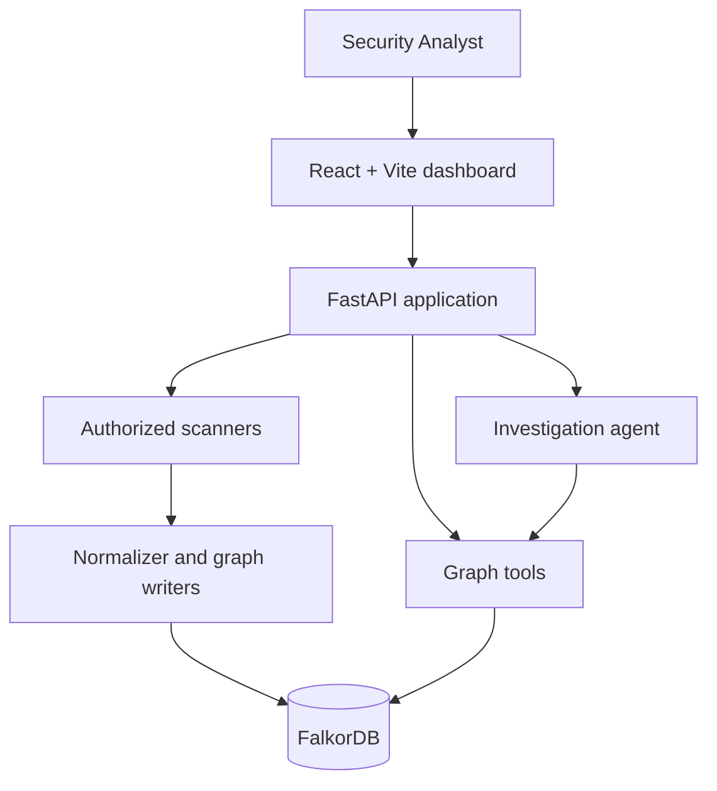

# TraceShield-AI — System Architecture

## Overview

TraceShield-AI is a graph-based security investigation platform. It connects security findings with supporting evidence and explores their potential impact through graph relationships and AI-assisted reasoning.

The current foundation contains Python security-analysis modules, FalkorDB integration, an AI investigation agent, a Streamlit dashboard, and the local DemoShop demonstration application. The target architecture adds a React + Vite frontend and FastAPI REST API so the user interface is separated from the existing Python analysis components.

**Implementation status:** the React/Vite and FastAPI directories are currently scaffolds. They must be implemented and validated before the new frontend is presented as connected to the backend.

## Goals

- Represent findings, evidence, endpoints, services, and data assets as graph entities.
- Ground investigations in retrieved evidence and graph relationships.
- Make impact analysis and AI responses explainable.
- Keep scanning, ingestion, graph operations, AI reasoning, API handling, and presentation separate.
- Permit only explicitly authorized, controlled security testing.
- Keep frontend and backend interfaces stable and documented.

## Layers

1. **Presentation:** React + Vite dashboard written in JavaScript.
2. **API:** FastAPI validation and orchestration.
3. **Security analysis:** scanners and finding normalization.
4. **Graph intelligence:** graph queries, traversals, and impact analysis.
5. **AI investigation:** registered tools and evidence-grounded reasoning.
6. **Data:** FalkorDB graph storage.



This diagram is the intended architecture, not a claim that every connection is already implemented.

## Component Responsibilities

### Frontend — planned

The React/Vite frontend displays projects, scan results, findings, evidence, graph relationships, and investigation results. `frontend/src/services/api.js` is the only frontend API boundary. Browser code must not connect to FalkorDB, import Python modules, execute scanners, or contain secrets.

Suggested future libraries include React Router for navigation, a server-state library such as TanStack Query, and Cytoscape.js for graph exploration. Their adoption is not yet an implementation requirement.

### FastAPI — planned

FastAPI will expose documented JSON endpoints, validate requests and responses, coordinate existing Python modules, enforce target authorization, configure CORS, and keep database/AI credentials server-side. Routes orchestrate services; they do not duplicate Cypher queries.

### Scanners and ingestion — partially implemented

Scanners operate only against approved targets and return structured observations. The ingestion layer normalizes scanner-specific output, preserves provenance and history, resolves entity identifiers consistently, and writes findings/evidence to FalkorDB. A missing result is not proof of remediation.

### Graph and AI — existing, subject to verification

`graph_db.py`, `graph_tools.py`, and `graph_intelligence.py` provide graph access and impact analysis. `agent.py` and `agent_graph_tools_v2.py` provide AI investigation capabilities. The agent must be restricted to registered tools, distinguish facts from hypotheses, and never receive unrestricted database or action-execution access.

## Main Data Flows

### Scanning and ingestion

1. An authorized user selects a registered project or approved demo target.
2. The API validates the requested scope and scan type.
3. The scanner collects an observation.
4. The ingestion layer normalizes it and resolves identifiers/provenance.
5. FalkorDB creates or updates the finding, evidence, and relationships.
6. The API returns a scan summary for the frontend.

### Graph exploration

1. The frontend requests a bounded graph view or finding details.
2. FastAPI calls controlled graph-query functions.
3. The backend serializes bounded nodes, edges, and supporting details.
4. The frontend renders and explores the returned graph.

### AI-assisted investigation

1. The user submits a question to FastAPI.
2. The backend validates it and invokes the investigation service.
3. The agent selects registered graph tools and retrieves evidence.
4. The API returns an explanation separately from its supporting evidence references.

### Verification and retesting

1. An authorized user requests a supported verification test.
2. The backend validates target, scope, and test type.
3. The normalized result is associated with the finding and scan run.
4. Only the finding actually tested may receive a justified lifecycle transition.

## Proposed API

The proposed API is REST with JSON bodies. See [API_SPEC.md](API_SPEC.md) for the non-binding initial endpoint inventory. Exact schemas, errors, filters, and asynchronous behavior must be defined before frontend implementation relies on them.

## Repository Organization

```text
TraceShield-AI/
├── docs/
├── api/
│   ├── main.py
│   ├── schemas.py
│   └── routes/
├── frontend/
│   ├── src/
│   │   ├── components/
│   │   ├── pages/
│   │   ├── features/
│   │   └── services/
│   └── package.json
├── scanners/
├── ingestion/
├── demoshop/
├── agent.py
├── agent_graph_tools_v2.py
├── graph_db.py
├── graph_tools.py
├── graph_intelligence.py
├── seed_graph.py
├── dashboard.py
├── requirements.txt
└── docker-compose.yml
```

`dashboard.py` remains available as the existing Streamlit development/demo interface during the transition unless deliberately retired later.

## Security and Testing

- Validate hostnames, URLs, ports, and scopes on the server before active tests.
- Use parameterized graph queries and keep graph writes in trusted backend workflows.
- Treat scanner output, graph properties, and repository content as untrusted agent input.
- Never expose API keys, database credentials, cookies, or authorization tokens.
- Test normalization, lifecycle transitions, API contracts, graph integration, agent tool handling, and the complete authorized-demo workflow.

The detailed working agreements live in [GRAPH_SCHEMA.md](GRAPH_SCHEMA.md), [IMPLEMENTATION_PLAN.md](IMPLEMENTATION_PLAN.md), and [SECURITY_AND_TESTING.md](SECURITY_AND_TESTING.md).
