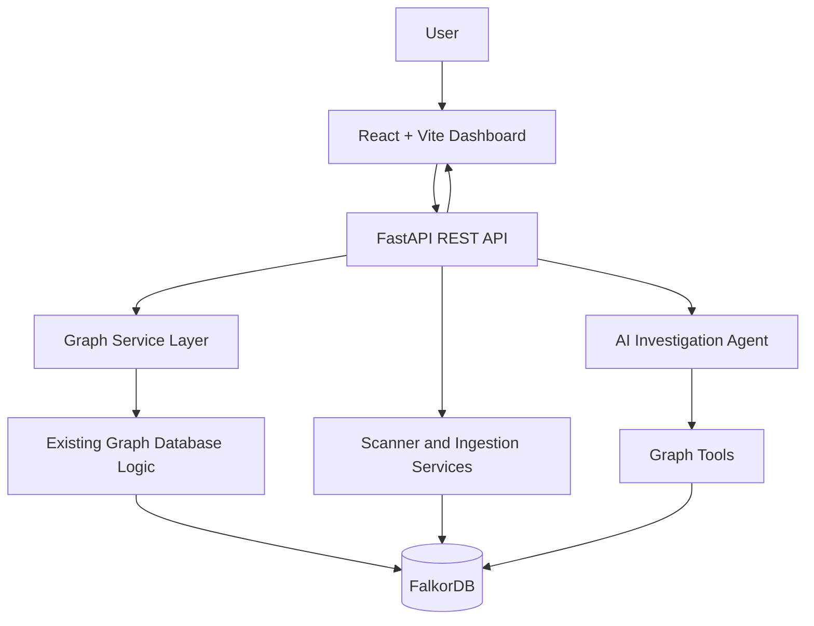

# Dashboard Specification

## 1. Purpose

This document defines the frontend dashboard for TraceShield-AI, a security investigation assistant that uses graph relationships to connect security findings, evidence, endpoints, services, and assets.

The dashboard will provide a unified interface for:

- Viewing security findings and project-level summaries.
- Exploring relationships between findings, evidence, endpoints, and other graph entities.
- Investigating security issues using graph-grounded AI assistance.
- Viewing scan history and scan results.
- Inspecting individual findings and their supporting evidence.

The existing repository includes a Streamlit dashboard. The React + Vite dashboard described here is the planned frontend and must be implemented without accidentally breaking existing functionality.

## 2. Prerequisites and Repository Awareness

Before implementing the dashboard, the coding agent must inspect the existing repository and distinguish implemented functionality from planned functionality.

Inspect the relevant files, including:

- `README.md`
- `graph_db.py`
- `graph_tools.py`
- `graph_intelligence.py`
- `seed_graph.py`
- `ingestion/normalizer.py`
- `ingestion/graph_writer.py`
- `ingestion/bola_writer.py`
- `scanners/http_headers.py`
- `scanners/bola_check.py`
- `agent.py`
- `agent_graph_tools_v2.py`
- `dashboard.py`
- `.env.example`
- `docker-compose.yml`
- `requirements.txt`

Before coding:

1. Identify the existing graph node labels, relationship types, identifiers, and query functions.
2. Determine the actual output format of graph queries and agent responses.
3. Reuse existing graph and investigation logic where appropriate.
4. Identify which backend capabilities require new implementation.
5. Avoid assuming that proposed API endpoints already exist.
6. Avoid replacing the existing Streamlit dashboard unless explicitly requested.
7. Do not introduce a second graph-query implementation that duplicates existing logic unnecessarily.

The implementation must preserve existing working features and document any changes to graph queries or schemas.

## 3. Technology Stack

### 3.1 Frontend

| Technology | Purpose |
|---|---|
| React | Component-based user interface |
| Vite | Frontend development server and build tooling |
| TypeScript | Type safety for components and API data |
| React Router | Client-side page navigation |
| Cytoscape.js | Interactive graph visualization |
| `cytoscape-fcose` | Force-directed graph layout |
| Axios | Shared HTTP client for backend API requests |
| CSS | Layout, styling, themes, and responsive design |

Use compatible, current package versions and verify installation and build compatibility before committing dependency changes.

### 3.2 Backend

| Technology or module | Responsibility |
|---|---|
| Python | Existing application and security tooling |
| FastAPI | Planned REST API for the frontend |
| FalkorDB | Graph database |
| `graph_db.py` | Existing graph database connection and query functionality |
| `graph_tools.py` | Existing graph tools and traversal functionality |
| `graph_intelligence.py` | Existing graph intelligence and analysis functionality |
| Graph service layer | Planned validation, query orchestration, and serialization |
| Pydantic | Request and response validation through FastAPI |
| Existing agent modules | Investigation and graph-grounded AI assistance |

Confirm which packages are already installed in `requirements.txt` before adding dependencies. Do not duplicate dependencies or replace working modules without a reason.

### 3.3 Graph Visualization Library Decision

**Use Cytoscape.js as the primary graph visualization library.**

The main graph explorer is a network exploration interface, not merely a flowchart editor. Cytoscape.js supports graph nodes, edges, network layouts, selection, traversal-oriented interactions, and large interactive network visualizations.

Use `cytoscape-fcose` as the preferred force-directed layout extension, provided its compatibility with the selected Cytoscape.js version is verified.

React Flow (`@xyflow/react`) is an alternative for custom node-card diagrams and workflow editors. Do not add both libraries to the primary graph explorer unless a separate, clearly defined requirement justifies the additional complexity.

## 4. Installation and Dependencies

### 4.1 Frontend Setup

From the React + Vite frontend directory, install the required packages:

```bash
npm install cytoscape cytoscape-fcose axios
```

If TypeScript is used, install the Cytoscape type definitions if the selected package version does not provide suitable built-in types:

```bash
npm install -D @types/cytoscape
```

Verify whether the installed `cytoscape-fcose` version includes its own type declarations before adding any extra type packages.

The project should also have the relevant React, Vite, TypeScript, and routing dependencies. Check `package.json` first and install only missing packages.

### 4.2 Backend Dependencies

The API layer is planned, so verify the backend environment before implementation. The likely API dependencies include:

```bash
pip install fastapi "uvicorn[standard]"
```

Pydantic may already be installed through FastAPI or existing dependencies. Verify the environment before adding it separately.

The FalkorDB Python client and existing agent/scanner dependencies should be reused where possible. Do not install a second database client or replace the current connection configuration without justification.

Record confirmed dependencies in the appropriate dependency files. Installation commands alone do not establish that a feature is implemented.

## 5. Architecture

The intended architecture is:



### Architectural rules

- The React frontend must not connect directly to FalkorDB.
- The frontend must not import or execute Python modules.
- FastAPI is the boundary between the frontend and backend.
- The graph service layer should reuse existing graph functionality.
- The graph service layer must validate inputs, limit query scope, and serialize results.
- The agent must ground investigation claims in retrieved graph data and supporting evidence.
- Scanning and other potentially long-running operations must not block ordinary dashboard requests indefinitely.
- Existing Streamlit functionality must remain available unless a deliberate migration is approved.

## 6. Dashboard Layout and Visual Direction

Use a dark security-operations interface with a restrained visual hierarchy.

### 6.1 Design Principles

- Dark background with readable text.
- Clear distinction between critical, high, medium, and low severity.
- Consistent spacing, typography, and component sizing.
- Minimal unnecessary animation.
- Graph colors that remain distinguishable against the background.
- Responsive layouts for desktop and tablet.
- Accessible keyboard navigation, focus states, and contrast.

### 6.2 Global Layout

The dashboard should include:

- **Sidebar:** Overview, Findings, Graph Explorer, Investigations, and Scans.
- **Top bar:** Project selector, current project context, and API/backend status.
- **Main content:** Page-specific information and interactions.
- **Feedback states:** Loading, error, empty, and success messages.

Do not display backend health as successful until the API has returned a valid health response.

## 7. Main Pages

### 7.1 Overview

Display a project summary with:

- Total findings.
- Findings grouped by severity.
- Open, confirmed, resolved, and accepted-risk counts when supported by backend data.
- Recent scans.
- Recently discovered findings.
- Shortcuts to the graph explorer and investigations.

All metrics must come from API responses. Do not fabricate placeholder findings or statistics in production views.

### 7.2 Findings

Provide a searchable and filterable list of findings.

Recommended columns:

- Finding identifier.
- Title.
- Severity.
- Status.
- Affected endpoint or asset.
- First detected or last observed timestamp.
- Associated scan.

Support pagination and filters for project, severity, status, scanner, and endpoint when the backend supports them.

Selecting a finding should open its detail view.

### 7.3 Finding Detail

Display:

- Finding title and description.
- Severity and lifecycle status.
- Affected endpoint, asset, or service.
- Evidence and scanner provenance.
- Detection timestamps and associated scan.
- Related graph entities.
- Available verification or retest information.

Clearly distinguish observed evidence from AI-generated interpretation. Never display a finding as resolved merely because a related test passed; resolution must be supported by the finding's own lifecycle and verification evidence.

### 7.4 Graph Explorer

The Graph Explorer is a core feature of TraceShield-AI. It must use Cytoscape.js to render graph data returned by the backend.

The graph explorer must support:

- Interactive graph rendering.
- Zoom and pan.
- Node selection.
- Edge inspection.
- Neighbor expansion.
- Search by node identifier or label.
- Node-type filtering.
- Relationship-type filtering.
- Severity-aware styling for finding nodes.
- Layout selection.
- Graph reset and fit-to-view.
- A details panel for the selected node or edge.
- Navigation from graph entities to their associated finding or investigation pages.

The graph must display only nodes and relationships returned by the backend. The frontend must not invent edges to make the visualization appear connected.

### 7.5 Investigations

Provide an interface for submitting a security investigation question and displaying the agent's response.

Where supported, show:

- Investigation question.
- Agent response.
- Supporting graph entities.
- Evidence references.
- Relevant relationships.
- Tool or query results.
- Limitations and unresolved questions.

The interface should make it possible to navigate from cited graph entities to their details in the graph explorer.

Do not treat an LLM-generated explanation as verified fact when the graph and evidence do not support it.

### 7.6 Scans

Display scan history, scan status, scan type, target project, timestamps, and result summaries.

If scan execution is supported through the API, provide a controlled way to initiate an authorized scan. Restrict scan targets to explicitly authorized environments and configured project scope.

Show queued, running, completed, and failed states only when those states are represented by the backend.

## 8. Graph Visualization Implementation

### 8.1 Data Flow

The required graph data flow is:

1. The user opens the Graph Explorer.
2. React requests an initial, bounded graph from the FastAPI API.
3. FastAPI validates the project and query parameters.
4. The graph service calls existing graph database or graph-tool functions.
5. The service normalizes database results into a stable API response.
6. React maps the response to Cytoscape.js nodes and edges.
7. The user selects a node or requests neighboring nodes.
8. React requests additional graph data from the API.
9. The frontend merges new entities without duplicating existing nodes or edges.

The frontend should not load the entire graph by default. Start with a bounded set of nodes and expand on demand.

### 8.2 Proposed Component Structure

A suitable implementation structure is:

```text
frontend/
  src/
    components/
      graph/
        GraphExplorer.tsx
        GraphCanvas.tsx
        GraphToolbar.tsx
        GraphLegend.tsx
        GraphNodeDetails.tsx
        GraphFilters.tsx
    pages/
      GraphPage.tsx
    services/
      apiClient.ts
      graphService.ts
    types/
      graph.ts
```

The exact structure may be adjusted to fit the existing repository. Avoid creating duplicate components if equivalent components already exist.

### 8.3 Graph Component Responsibilities

**`GraphExplorer.tsx`**

- Coordinates graph data, filters, selection, and expansion state.
- Connects the graph canvas to the graph API.
- Handles loading, error, and empty states.

**`GraphCanvas.tsx`**

- Initializes and renders Cytoscape.js.
- Registers the selected layout.
- Applies graph styling.
- Handles node and edge selection.
- Cleans up Cytoscape.js resources when the component unmounts.

**`GraphToolbar.tsx`**

- Provides fit-to-view, reset, zoom, and layout controls.
- Exposes only controls that are implemented and functional.

**`GraphLegend.tsx`**

- Explains node types, relationship types, and severity styling.

**`GraphNodeDetails.tsx`**

- Displays the selected node's available properties and identifiers.
- Provides links to relevant findings or investigations when supported.

**`GraphFilters.tsx`**

- Filters nodes and relationships by supported types and attributes.
- Makes it clear whether filtering affects the current display or the backend query.

**`graphService.ts`**

- Calls graph-related API endpoints.
- Converts API errors into consistent frontend errors.
- Does not query FalkorDB directly.

### 8.4 Cytoscape.js Integration

Register the layout extension once during application initialization, rather than repeatedly during component rendering.

Example:

```tsx
import cytoscape from "cytoscape";
import fcose from "cytoscape-fcose";

cytoscape.use(fcose);
```

The graph canvas should use a React effect to create the Cytoscape instance after the container element is available.

Conceptual lifecycle:

1. Obtain a reference to the graph container.
2. Initialize Cytoscape.js with the current nodes, edges, style, and layout.
3. Register event handlers for node and edge selection.
4. Update the instance when graph data or relevant styling changes.
5. Remove event listeners and destroy the instance during cleanup.

Avoid creating a new Cytoscape instance on every render. Prefer updating the existing instance where practical, and ensure that React state remains synchronized with graph interactions.

Use stable graph identifiers for Cytoscape element IDs. Sanitize or encode identifiers when needed to meet the chosen graph API's ID constraints.

### 8.5 Node and Edge Styling

Use visually distinct node types, for example:

| Graph entity | Suggested visual treatment |
|---|---|
| Project | Distinct root or container style |
| Finding | Severity-aware node |
| Evidence | Evidence/document icon or shape |
| Endpoint | Endpoint-specific style |
| Service | Service-specific style |
| Asset | Asset-specific style |
| ScanRun | Scan-specific style |
| Investigation | Investigation-specific style |

These are presentation recommendations, not a claim that every node label already exists in the database. Confirm the real graph schema before enabling a type.

Severity colors should be consistent with the Findings page. Ensure that severity is not conveyed by color alone; labels, icons, or textual details should also communicate meaning.

Edges should have a clear direction where the underlying relationship is directed. The legend and details panel should display the actual relationship type rather than a fabricated description.

### 8.6 Graph Layouts

The primary layout should use `cytoscape-fcose` for force-directed graph exploration.

Provide a small number of useful layouts if the installed libraries and graph structure support them:

- **Force-directed:** General-purpose relationship exploration.
- **Hierarchical:** Useful for dependency or parent-child structures when the data supports a meaningful hierarchy.
- **Circular:** Useful for reviewing a bounded set of related entities.

Do not imply that the layout itself proves causality, attack paths, or dependency direction. Layout is a visual arrangement of the supplied graph data.

### 8.7 Node Expansion and Graph State

When a user expands a node:

1. Request its neighbors using the node's stable ID.
2. Apply backend limits and filters.
3. Merge returned nodes and edges with the current graph.
4. Deduplicate nodes by stable node ID.
5. Deduplicate edges using a stable edge ID or a documented composite key.
6. Preserve the selected node where possible.
7. Update the graph without resetting the entire view unnecessarily.

Handle missing nodes, deleted entities, empty neighborhoods, and API failures gracefully.

Do not silently drop edges because their endpoint nodes are missing. Validate the response and either fetch the required endpoints or report malformed graph data.

### 8.8 Graph Performance

To keep the interface responsive:

- Use bounded initial graph queries.
- Support pagination or incremental neighbor expansion where appropriate.
- Set practical limits for nodes and edges returned per request.
- Avoid repeated database requests for the same expansion when cached data is still valid.
- Avoid rerunning expensive layouts on every minor state update.
- Keep graph data transformation separate from presentation code.
- Test with graphs larger than the initial demo dataset.
- Display a clear message when a result is truncated or limited.

If the graph exceeds practical rendering limits, encourage filtering or neighborhood-based exploration instead of rendering an unbounded graph.

## 9. Graph API Contract

The API endpoints in this section are proposed. They must not be treated as existing until implemented and tested.

### 9.1 Initial Graph Request

Proposed endpoint:

```http
GET /api/graph?project_id=demo-shop&limit=100
```

The backend should return a bounded collection of graph nodes and edges scoped to the selected project.

### 9.2 Neighbor Expansion

Proposed endpoint:

```http
GET /api/graph/nodes/{node_id}/neighbors?depth=1&limit=50
```

The endpoint should validate the node ID, restrict traversal depth, enforce result limits, and return the requested node neighborhood.

The API must not allow arbitrary unbounded graph traversal from user-controlled parameters.

### 9.3 Suggested Response Format

```json
{
  "project_id": "demo-shop",
  "nodes": [
    {
      "id": "finding-F-003",
      "label": "Finding",
      "properties": {
        "title": "Missing Content Security Policy",
        "severity": "medium",
        "status": "open"
      }
    },
    {
      "id": "endpoint-catalog",
      "label": "Endpoint",
      "properties": {
        "path": "/api/catalog"
      }
    }
  ],
  "edges": [
    {
      "id": "edge-finding-endpoint-001",
      "source": "finding-F-003",
      "target": "endpoint-catalog",
      "type": "AFFECTS",
      "properties": {}
    }
  ],
  "meta": {
    "truncated": false,
    "returned_nodes": 2,
    "returned_edges": 1
  }
}
```

This is an illustrative contract, not a representation of guaranteed existing database records. Confirm the actual schema and use real graph data.

### 9.4 Contract Requirements

- Every node must have a stable ID and type/label.
- Every edge must have stable identity or a documented deduplication key.
- Edge source and target IDs must refer to returned or otherwise resolvable nodes.
- Preserve the real relationship type.
- Return only properties needed by the dashboard.
- Do not expose secrets, credentials, session tokens, or unnecessary sensitive data.
- Include truncation or pagination metadata when results are bounded.
- Validate project scope, node IDs, traversal depth, and limits.
- Keep internal database result objects out of the public API response.

## 10. Proposed FastAPI Graph Service

Create a graph service layer if the existing code does not already provide an appropriate equivalent.

Possible structure:

```text
backend/
  app/
    main.py
    api/
      routes/
        health.py
        projects.py
        findings.py
        graph.py
        scans.py
        investigations.py
    services/
      graph_service.py
      finding_service.py
      scan_service.py
      investigation_service.py
    schemas/
      graph.py
      finding.py
      scan.py
      investigation.py
```

Do not create duplicate modules solely to match this example. Adapt it to the current repository structure.

The graph service should:

- Reuse existing FalkorDB connection logic.
- Reuse suitable graph queries and traversal functions.
- Validate user-provided query parameters.
- Apply project scope and traversal limits.
- Normalize database results.
- Deduplicate nodes and edges.
- Return stable, documented API structures.
- Handle database errors without exposing credentials or internal stack traces.
- Avoid executing arbitrary Cypher supplied directly by the frontend.

Keep database access and graph traversal out of React components and API route handlers where a dedicated service layer is appropriate.

## 11. Shared Frontend API Client

Use a single configured API client for backend communication.

Example:

```ts
// src/services/apiClient.ts
import axios from "axios";

export const apiClient = axios.create({
  baseURL: import.meta.env.VITE_API_URL ?? "http://localhost:8000/api",
  timeout: 15000,
  headers: {
    "Content-Type": "application/json",
  },
});
```

Example environment configuration:

```env
VITE_API_URL=http://localhost:8000/api
```

This example assumes the API is mounted under `/api`. Keep the backend route prefix and frontend base URL consistent.

Do not put FalkorDB credentials, Gemini API keys, or other backend secrets in frontend environment variables. Variables prefixed with `VITE_` are exposed to the browser bundle.

Create typed service functions for graph, findings, projects, scans, and investigations. Keep request logic out of presentation components where practical.

## 12. API Error and Loading States

Every page and graph interaction must support:

- Loading state.
- Empty state.
- Error state.
- Retry where appropriate.
- Partial or truncated result messaging.
- Clear distinction between unavailable data and a confirmed absence of findings.

For graph requests, do not show an empty graph as though it were a successful query if the API request failed.

Avoid automatically retrying expensive traversal requests indefinitely. Use bounded retries only where appropriate.

## 13. Frontend State Management

Use local React state for simple page and graph interactions initially.

Keep state for:

- Selected project.
- Current graph nodes and edges.
- Selected node or edge.
- Active graph filters.
- Layout selection.
- Expanded node IDs.
- Loading and error status.

Introduce a dedicated shared state library only if cross-page requirements justify it. Do not add another dependency simply because it is available.

Graph data should have one authoritative frontend representation. Ensure that neighbor expansion, filtering, and selection do not create inconsistent copies of the graph.

## 14. Accessibility and Responsive Behavior

The dashboard must:

- Support keyboard navigation for menus, filters, and page controls.
- Provide visible focus states.
- Use sufficient text and status contrast.
- Avoid relying on color alone to indicate severity.
- Provide an accessible details panel for selected graph entities.
- Provide a searchable or tabular alternative for graph entities where practical.
- Handle smaller screens without hiding critical finding information.

The graph canvas itself may require specialized keyboard and screen-reader support. Where direct graph interaction is not accessible, provide an equivalent list or details-based navigation path.

## 15. Security Requirements

- Restrict access to explicitly authorized projects and scan targets.
- Do not allow the frontend to send arbitrary database queries.
- Enforce traversal depth and result limits on the backend.
- Validate and sanitize user-controlled parameters.
- Configure CORS for known frontend origins rather than allowing every origin by default in production.
- Keep secrets on the backend.
- Avoid exposing internal database errors or sensitive graph properties.
- Treat scanner output and graph properties as untrusted input.
- Escape or safely render user-controlled text.
- Do not allow graph labels or evidence to inject executable HTML.
- Ground AI investigation output in graph results and evidence.
- Keep potentially destructive scanner operations disabled unless explicitly authorized and safely controlled.
- Do not treat graph visualization as proof that an attack path is exploitable.

Before exposing the API beyond localhost or a trusted development environment, implement appropriate authentication, authorization, network controls, logging, and deployment hardening.

## 16. Testing Requirements

### 16.1 Frontend Tests

Test:

- Dashboard navigation.
- Loading, empty, and error states.
- Finding filters and pagination.
- Graph rendering from valid API data.
- Node and edge selection.
- Neighbor expansion.
- Duplicate node and edge prevention.
- Layout changes.
- Graph cleanup on component unmount.
- Invalid graph data handling.
- Responsive layout and accessibility basics.

### 16.2 Backend Tests

Test:

- Graph response serialization.
- Node and edge identity consistency.
- Missing node behavior.
- Bounded neighbor traversal.
- Invalid depth and limit parameters.
- Project scoping.
- Database errors.
- Prevention of arbitrary query execution.
- API response schema validation.

### 16.3 Integration Tests

Use a dedicated test graph or isolated test database. Do not run tests against production or unrelated user data.

Verify that:

1. A known graph can be queried through the backend.
2. The API returns stable node and edge identifiers.
3. The frontend renders the returned graph.
4. Expanding a node retrieves the correct neighbors.
5. Repeated expansion does not create duplicates.
6. Graph failures are shown clearly to the user.
7. Existing Streamlit and scanner workflows continue to function.

### 16.4 Build Validation

Before declaring the dashboard complete, verify:

- Frontend dependency installation.
- TypeScript checks.
- Production build.
- Backend import and startup.
- API health check.
- Graph API tests.
- End-to-end graph exploration.
- No frontend access to database credentials or direct database connections.

Record the actual commands executed and their results. Do not claim a test passed if it was not run.

## 17. Implementation Order

Recommended implementation sequence:

1. Audit the current graph schema and existing query functions.
2. Confirm the frontend directory and package manager.
3. Define and document the graph API response contract.
4. Implement or adapt the backend graph service.
5. Implement bounded graph and neighbor endpoints.
6. Test graph serialization and endpoint validation.
7. Install and register Cytoscape.js and `cytoscape-fcose`.
8. Implement the graph canvas and basic layout.
9. Add node/edge selection and the details panel.
10. Add neighbor expansion with deduplication.
11. Add filters, search, and layout controls.
12. Connect the graph explorer to real project data.
13. Add loading, error, empty, and truncated-result states.
14. Test larger graphs, accessibility, and performance.
15. Integrate the graph explorer into the dashboard navigation.
16. Run regression tests for existing backend, scanner, agent, and Streamlit functionality.

Do not build a graph UI around mock data and treat it as complete. Mock data may be used for isolated component development, but the final integration must use the backend contract.

## 18. Out of Scope for the Initial Dashboard

Unless separately approved, the first version does not need:

- Arbitrary Cypher query editing in the browser.
- Unbounded full-database visualization.
- Destructive remediation actions.
- Automatic scanning of arbitrary public targets.
- An additional graph database.
- A second graph visualization library for the same explorer.
- Unsupported claims about exploitability or attack paths.
- Full replacement of the existing Streamlit dashboard before feature parity is assessed.

## 19. Definition of Done

The dashboard is complete when:

- React + Vite builds successfully.
- The frontend communicates with FastAPI through the shared API client.
- FalkorDB is accessed only through backend services.
- Cytoscape.js renders real graph data returned by the API.
- The selected graph layout works with the installed library versions.
- Node and edge selection show real entity details.
- Neighbor expansion retrieves bounded backend results.
- Repeated expansion does not duplicate nodes or edges.
- Graph filters and controls behave as documented.
- The graph is navigable without requiring a full-database load.
- Loading, empty, error, and truncated-result states work correctly.
- The API validates project scope and traversal limits.
- Secrets and sensitive database properties are not exposed to the browser.
- Tests cover graph serialization, graph interactions, and API validation.
- Existing project functionality has been regression-tested.
- Documentation accurately identifies implemented versus planned capabilities.

## 20. Instructions for the Coding Agent

Before making changes, inspect the current repository and identify existing modules, conventions, and graph schema.

Then:

1. Report which dashboard and graph capabilities already exist.
2. Compare the current implementation with this specification.
3. Identify the smallest set of required changes.
4. Implement changes incrementally.
5. Reuse existing graph queries and database connections where appropriate.
6. Add or update tests alongside implementation.
7. Run the available checks and report their actual results.
8. Update documentation to match the final implementation.
9. Clearly list any incomplete requirements or compatibility issues.

Do not invent graph data, silently change existing node identifiers, expose database access to the browser, or claim that a feature is complete before it has been implemented and tested.
