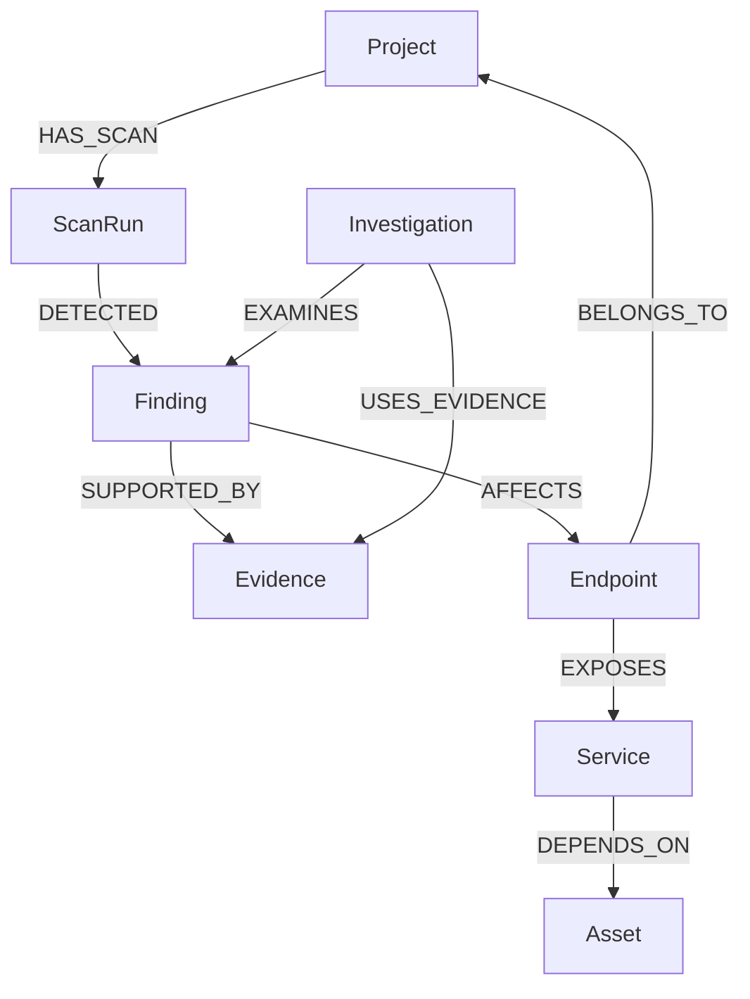

# TraceShield-AI — Graph Schema

## 1. Purpose and Status

This document defines the canonical FalkorDB data model for applications, scan runs, findings, evidence, endpoints, services, assets, and investigations. It supports security analysis, impact exploration, evidence retrieval, and AI-assisted investigation.

This is the proposed canonical schema. Before changing writers or queries, reconcile it with `graph_db.py`, `graph_tools.py`, `graph_intelligence.py`, `seed_graph.py`, and `ingestion/`.

Read [GRAPH_SCHEMA_PREREQUISITES.md](GRAPH_SCHEMA_PREREQUISITES.md) before beginning schema work.

## 2. Design Principles

- Every persistent entity has a stable identifier.
- A finding is a tracked issue; evidence is an individual observation that supports, qualifies, or contradicts it.
- New scans preserve history rather than overwrite observations.
- Edges require scanner output, trusted application metadata, repository analysis, or a documented inference rule.
- AI conclusions must distinguish observations, inferred impact, and unverified hypotheses.
- Seeding and ingestion use the same canonical entity identifiers.

## 3. Graph Overview



This is the target conceptual model. Existing Cypher must be updated together with any label or relationship migration.

## 4. Node Definitions

### Project

| Property | Required | Description |
|---|---|---|
| `id` | Yes | Stable project identifier |
| `name` | Yes | Display name |
| `target_type` | Yes | For example `web_app` or `repository` |
| `target_ref` | No | Canonical approved target or repository reference; never a secret |
| `created_at` | Yes | Creation time |
| `updated_at` | No | Last update time |

### ScanRun

| Property | Required | Description |
|---|---|---|
| `id` | Yes | Unique execution identifier |
| `project_id` | Yes | Owning project |
| `scanner` | Yes | Scanner or integration name |
| `status` | Yes | `queued`, `running`, `completed`, `failed`, or `cancelled` |
| `started_at`, `completed_at` | No | Execution timestamps |
| `error_summary` | No | Sanitized error summary |
| `created_at` | Yes | Record creation time |

A scan is an execution, not a vulnerability. It may observe multiple findings and a finding may be observed by multiple scans.

### Finding

| Property | Required | Description |
|---|---|---|
| `id` | Yes | Stable finding identifier |
| `project_id` | Yes | Owning project |
| `fingerprint` | Yes | Stable deduplication key |
| `title`, `category`, `severity`, `status` | Yes | Finding classification and lifecycle |
| `description` | No | Details |
| `first_seen_at`, `last_seen_at`, `remediated_at` | No | Lifecycle timestamps |
| `created_at`, `updated_at` | Yes/No | Audit timestamps |

Severity values: `critical`, `high`, `medium`, `low`, `informational`, or `unknown`.

Lifecycle values: `open`, `confirmed`, `inconclusive`, `remediated`, and `reopened`. A later absent scan result never proves remediation.

### Evidence

| Property | Required | Description |
|---|---|---|
| `id` | Yes | Unique observation identifier |
| `project_id` | Yes | Owning project |
| `source`, `evidence_type`, `summary`, `observed_at` | Yes | Provenance and human-readable observation |
| `scan_id` | No | Related scan execution |
| `confidence` | No | Range 0–1 |
| `details_ref` | No | Controlled artifact reference |
| `created_at` | Yes | Record creation time |

Examples: `http_header`, `http_response`, `static_analysis`, `dependency_analysis`, `authorization_test`, `configuration`, and `manual_review`. Evidence is immutable where practical; a changed observation creates new evidence.

### Endpoint

| Property | Required | Description |
|---|---|---|
| `id`, `project_id`, `path`, `created_at` | Yes | Stable project-scoped route identity |
| `method`, `url` | No | HTTP method and approved canonical URL |

Use normalized route templates. Query parameters, session values, and sensitive URL parts must not create duplicate endpoints. Distinguish HTTP methods when relevant.

### Service

| Property | Required | Description |
|---|---|---|
| `id`, `project_id`, `name`, `created_at` | Yes | Stable project-scoped component identity |
| `service_type`, `version` | No | Known classification and reliable version metadata |

### Asset

| Property | Required | Description |
|---|---|---|
| `id`, `project_id`, `name`, `asset_type`, `created_at` | Yes | Stable asset identity and type |
| `sensitivity` | No | Data sensitivity classification |

Never store passwords, tokens, or other secrets as asset properties.

### Investigation

| Property | Required | Description |
|---|---|---|
| `id`, `project_id`, `question`, `status`, `created_at` | Yes | Investigation identity and lifecycle |
| `answer_summary` | No | Final explanation |
| `started_at`, `completed_at` | No | Execution timestamps |

Investigation statuses are `queued`, `running`, `completed`, or `failed`. Persistence is optional until implemented; non-persistent results must not claim to be saved.

## 5. Relationship Definitions

| Relationship | Source | Target | Meaning |
|---|---|---|---|
| `HAS_SCAN` | Project | ScanRun | Project has an execution |
| `DETECTED` | ScanRun | Finding | Scan reported finding |
| `SUPPORTED_BY` | Finding | Evidence | Evidence supports or qualifies finding |
| `AFFECTS` | Finding | Endpoint | Finding affects endpoint |
| `BELONGS_TO` | Endpoint | Project | Endpoint ownership |
| `EXPOSES` | Endpoint | Service | Endpoint routes to/exposes service |
| `DEPENDS_ON` | Service | Asset | Service uses asset |
| `EXAMINES` | Investigation | Finding | Investigation examines finding |
| `USES_EVIDENCE` | Investigation | Evidence | Investigation used evidence |
| `RELATED_TO` | Finding | Finding | Supported relationship between findings |

Unknown relationships remain absent. `DETECTED` is not proof of exploitability; `RELATED_TO` should retain a reason or provenance when practical. Contradictory evidence can later use `CONTRADICTED_BY` or an assessment node.

## 6. Identity and Deduplication

Every node uses a unique `id` within its graph namespace. Recommended identities:

| Entity | Identity rule |
|---|---|
| Project | Stable project UUID or canonical key |
| ScanRun, Evidence, Investigation | Unique identifier for each execution/observation/investigation |
| Finding | Stable ID resolved by fingerprint |
| Endpoint, Service, Asset | Project-scoped canonical identifier |

The finding fingerprint is deterministic from the project, scanner/rule identifier, category, canonical endpoint or source location, and relevant resource identity. It must exclude timestamps, temporary request IDs, and dynamic response bodies.

Before creating an entity, writers must resolve an equivalent existing entity. They may update appropriate mutable fields but must preserve historical evidence and relationships.

## 7. Finding Lifecycle and Retesting

### First detection

1. Resolve/create `Project` and `ScanRun`.
2. Compute the fingerprint and resolve/create `Finding`.
3. Create an `Evidence` node.
4. Link scan to finding, finding to evidence, and finding to affected entities when supported.

### Later detection or retest

1. Resolve the existing finding by fingerprint.
2. Create new evidence; never overwrite the historical observation.
3. Link the new scan and update `last_seen_at`.
4. Reopen a remediated finding only when a valid observation confirms recurrence.

A successful retest is a new observation. It may mark only the tested finding `remediated`, and only when the test verifies the relevant issue. Missing, failed, skipped, unauthenticated, or inconclusive tests do not prove remediation.

## 8. Provenance and Query Requirements

Preserve scanner name/version, scan ID, timestamp, target project/endpoint, rule/category, evidence summary, controlled artifact reference, confidence, and whether a relationship was observed or inferred.

The graph and API must support:

- Project findings filtered by severity, status, category, or scan.
- Finding evidence with scan context and timestamps.
- Bounded impact traversal from finding to endpoint, service, and asset.
- Related-finding discovery through shared justified entities.
- Scan comparison: new, persistent, resolved, reopened, and inconclusive observations.
- Bounded frontend nodes-and-edges responses.

Example frontend graph response:

```json
{
  "nodes": [{"id": "finding-001", "label": "Finding", "properties": {"severity": "medium", "status": "open"}}],
  "edges": [{"id": "edge-001", "source": "finding-001", "target": "evidence-001", "type": "SUPPORTED_BY"}]
}
```

The API transforms database records into this stable representation and never exposes credentials or sensitive artifacts.

## 9. Constraints, Migration, and Definition of Done

Enforce non-empty IDs, valid project references, required evidence provenance, stable fingerprints, valid relationship endpoints, bounded queries, and server-side lifecycle validation. Scanner failures cannot be successful verification. Sensitive data must not be unnecessarily stored in graph properties.

Introduce this schema incrementally: inspect current seed/writer/query behavior, map existing labels and IDs, update writers and queries together, then validate with seeded DemoShop data and controlled scans. Do not rename labels or delete nodes solely to match this document without checking dependent queries.

It is ready for API/frontend integration when labels and edges match implementation, IDs remain stable across seeding and ingestion, repeated scans deduplicate findings while retaining evidence, retesting has correct scope, graph traversals are justified, the API can serialize bounded graph data, and automated tests cover creation, updates, deduplication, and lifecycle transitions.

## 10. Future Extensions

Possible future additions include source files/functions, packages and dependencies, CVEs/CWEs, authorization roles, attack-path hypotheses, explicit verification results, multi-project analysis, and historical remediation metrics. Add these only when the supporting data and workflow exist.
